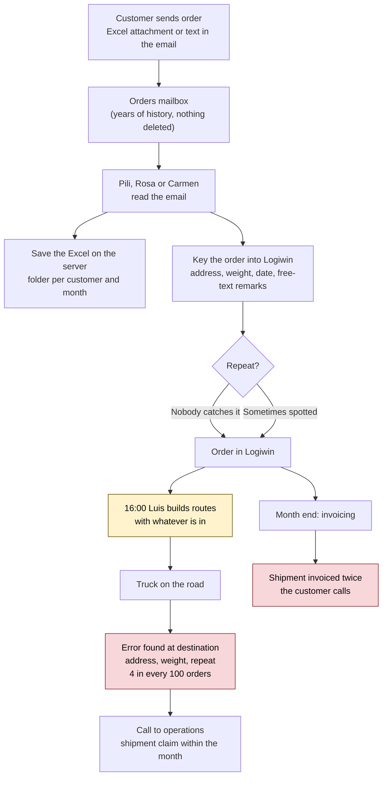
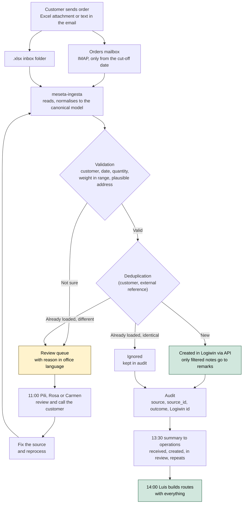

# Process — How an order gets in today and how it will

> FDE course · Assignment 01 · [Versión en español](../es/03-proceso.md)
>
> Source: interview with the head of operations at Transportes Meseta
> (October 2026) and the initial brief. Anything that did not come up in the
> interview is marked as *assumption*.

## 1. Who is involved

| Who | Role in the process |
| --- | --- |
| Customers (Agroalimentaria, Logística Sanz, Cerámicas, Muebles Cifuentes) | Send Excel or email to the orders mailbox. Agroalimentaria sends one large Excel first thing on Monday. |
| Pili, Rosa and Carmen (back office) | Read every order and key it into Logiwin, remarks included. Three people for this and for everything else in the office. |
| Luis (planning) | Builds the next day's routes from what is in Logiwin. |
| Drivers | Discover wrong addresses and weights on the road. |
| Head of operations | Answers for trucks and customers. Takes the call when something goes wrong. |
| Javier (management) | Costs, payroll and invoicing. Liaison with the advisors. |

## 2. Current process (as-is)

What goes wrong, in order of pain for the head of operations:

1. **Errors are found late.** A wrong address or weight shows up when the
   truck is already in Alcalá, not in the office.
2. **Repeats reach invoicing.** Logiwin does not stop them (*assumption*,
   pending Q6) and the customer calls at month end.
3. **Monday does not make it.** At 14:00 the Agroalimentaria file is not fully
   in, and at 16:00 Luis plans Tuesday with what is there.

A Monday first thing today, in detail:

| Time | What happens |
| --- | --- |
| First thing | The Agroalimentaria file and the weekend's emails arrive. |
| Morning | The three back-office staff type. Everything else in the office waits. |
| 14:00 | Part of the file is still missing. |
| 16:00 | Luis builds Tuesday's routes with what is in. |
| Tuesday on the road | Mistyped addresses and weights show up. |

## 3. Target process (to-be)

A Monday with the system running:

| Time | What happens |
| --- | --- |
| First thing | The Agroalimentaria file arrives. The system processes it in full on the next cycle. |
| Within 1-2 h | Every order is in Logiwin or in the review queue with its reason. |
| 11:00 | The back office gets the list of doubtful orders, checks them and calls whoever is needed. |
| 13:30 | Summary to operations: what came in, what is missing, what was repeated. |
| 14:00 | Luis builds Tuesday's routes with everything. |
| Month end | No shipment invoiced twice because of a repeated order. |

## 4. What changes for each person

| Who | Before | After |
| --- | --- | --- |
| Pili, Rosa and Carmen | Typing all morning | Reviewing the doubtful queue and calling customers |
| Luis | Planning at 16:00 with what is in | Planning at 14:00 with everything |
| Drivers | Finding errors at destination | Fewer surprises; doubts were settled in the office |
| Head of operations | Calls about errors and double invoices | A daily summary and zero duplicate shipments |
| Javier | Nothing changes in invoicing: Logiwin remains the source | One pending conversation with the advisors about data retention |

## 5. What this process does not touch

- Invoicing and claims stay in Logiwin.
- The history of emails, Excel files and orders since 2017 is not deleted
  from here. This system's retention (RNF-03) applies only to what it stores.
- Orders by phone, PDF or image are still keyed in by hand.

## 6. Process decisions derived from the interview

- The review queue is part of the normal path, not an exception. It is
  designed so a back-office person can check it at 11:00 without opening
  another tool (an email with the list and reasons).
- No automation target: the system loads only what it is sure about (RNF-10).
- The day's summary is sent before routes are built, not at end of day (RF-10).
- Office time and per-person counts are not measured.
