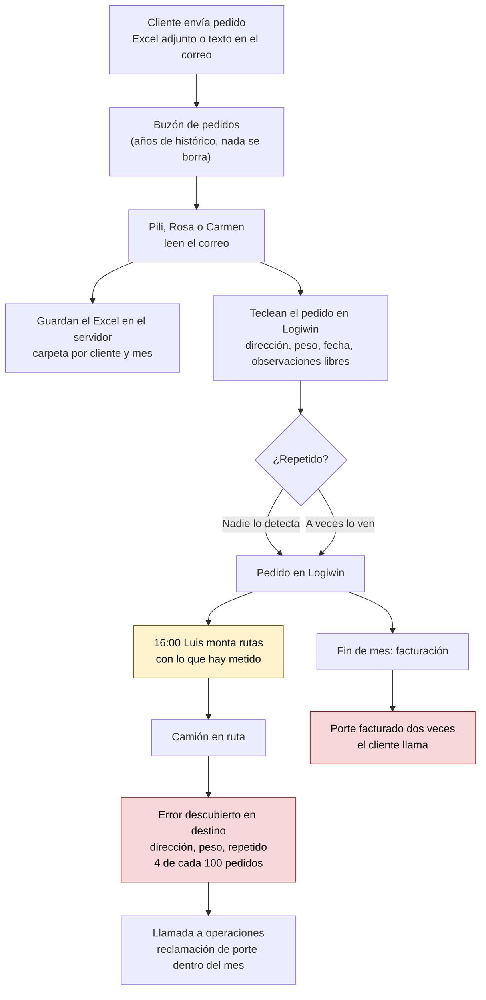
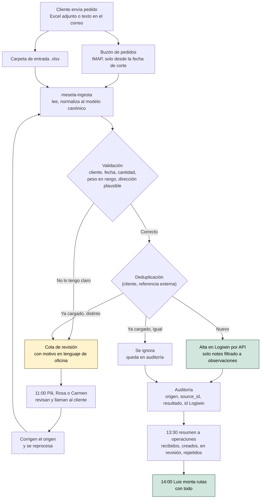

# Proceso — Cómo entra un pedido hoy y cómo entrará

> Curso FDE · Encargo 01 · [English version](../en/03-process.md)
>
> Fuente: entrevista con la responsable de operaciones de Transportes Meseta
> (octubre de 2026) y brief inicial. Lo que no salió en la entrevista está
> marcado como *supuesto*.

## 1. Quién interviene

| Quién | Papel en el proceso |
| --- | --- |
| Clientes (Agroalimentaria, Logística Sanz, Cerámicas, Muebles Cifuentes) | Envían Excel o correo al buzón de pedidos. Agroalimentaria manda un Excel grande el lunes a primera hora. |
| Pili, Rosa y Carmen (administración) | Leen cada pedido y lo teclean en Logiwin, observaciones incluidas. Son tres personas para esto y para todo lo demás de la oficina. |
| Luis (planificación) | Monta las rutas del día siguiente a partir de lo que hay en Logiwin. |
| Conductores | Descubren en ruta las direcciones y pesos mal metidos. |
| Responsable de operaciones | Responde por camiones y clientes. Recibe la llamada cuando algo sale mal. |
| Javier (gerencia) | Costes, nóminas y facturación. Interlocutor con la asesoría. |

## 2. Proceso actual (as-is)

Lo que falla, en orden de dolor para la responsable:

1. **Los errores se descubren tarde.** Dirección o peso mal metidos se ven
   cuando el camión ya está en Alcalá, no en la oficina.
2. **Los repetidos llegan a facturar.** Logiwin no los frena (*supuesto*,
   pendiente Q6) y el cliente llama a fin de mes.
3. **El lunes no se llega.** A las 14:00 el Excel de Agroalimentaria no está
   entero y a las 16:00 Luis planifica el martes con lo que hay.

Hoy un lunes a primera hora, en detalle:

| Hora | Qué pasa |
| --- | --- |
| Primera hora | Llega el Excel de Agroalimentaria y el resto del fin de semana. |
| Mañana | Las tres administrativas teclean. Todo lo demás de la oficina espera. |
| 14:00 | Todavía falta parte del Excel. |
| 16:00 | Luis monta las rutas del martes con lo que está metido. |
| Martes en ruta | Aparecen las direcciones y pesos mal tecleados. |

## 3. Proceso objetivo (to-be)

Un lunes con el sistema en marcha:

| Hora | Qué pasa |
| --- | --- |
| Primera hora | Llega el Excel de Agroalimentaria. El sistema lo procesa entero en el siguiente ciclo. |
| Hasta 1-2 h después | Cada pedido está en Logiwin o en la cola de revisión con su motivo. |
| 11:00 | Administración recibe la lista de dudosos, los mira y llama a quien haga falta. |
| 13:30 | Resumen a operaciones: qué ha entrado, qué falta, qué se ha repetido. |
| 14:00 | Luis monta las rutas del martes con todo. |
| Fin de mes | Ningún porte facturado dos veces por un pedido repetido. |

## 4. Qué cambia para cada persona

| Quién | Antes | Después |
| --- | --- | --- |
| Pili, Rosa y Carmen | Teclear toda la mañana | Revisar la cola de dudosos y llamar a clientes |
| Luis | Planificar a las 16:00 con lo que hay | Planificar a las 14:00 con todo |
| Conductores | Descubrir errores en destino | Menos sorpresas; lo dudoso se resolvió en la oficina |
| Responsable de operaciones | Llamadas por errores y por facturas dobles | Resumen diario y cero portes duplicados |
| Javier | Nada cambia en facturación: Logiwin sigue siendo la fuente | Una conversación pendiente con la asesoría sobre retención de datos |

## 5. Lo que este proceso no toca

- La facturación y las reclamaciones siguen en Logiwin.
- El histórico de correos, Excel y pedidos desde 2017 no se borra desde aquí.
  La retención de este sistema (RNF-03) solo aplica a lo que él guarda.
- Los pedidos por teléfono, PDF o imagen siguen tecleándose a mano.

## 6. Decisiones de proceso derivadas de la entrevista

- La cola de revisión es parte del camino normal, no una excepción. Se diseña
  para que la mire una administrativa a las 11:00 sin abrir otra herramienta
  (correo con la lista y motivos).
- Ningún objetivo de automatización: el sistema carga solo lo que tiene claro
  (RNF-10).
- El resumen del día se manda antes de montar rutas, no al final del día (RF-10).
- No se mide tiempo de oficina ni pedidos por persona.
